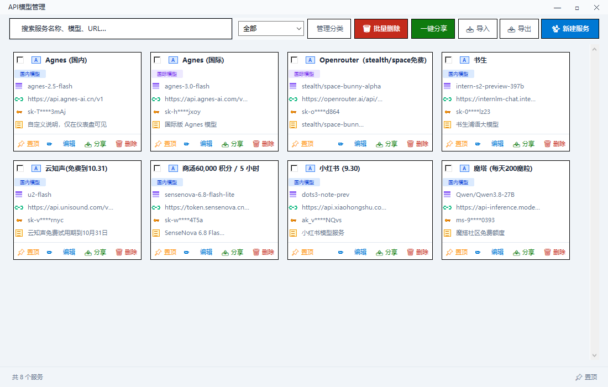

# 模型管理

卡通风格的 Windows AI API Key 管理工具：把各家大模型的 API Key、Base URL、模型名集中到一张张卡片里，
搜索、分类、复制、分享、导入导出都在一个窗口完成。单文件绿色版，配置保存在 exe 同目录的 `api_keys.json`，
拷走整个文件夹就能换电脑使用。

当前版本：**v1.1.4**（自动检测更新 + 自适应布局版）

## 功能

- **服务卡片**：名称、模型、Base URL、密钥掩码、备注一目了然
- **搜索**：按服务名称 / 模型 / URL 实时筛选
- **分类**：全部、国内模型、国际模型，可自定义分类并管理
- **服务管理**：新建、编辑、删除，多选批量删除、批量分享
- **复制与分享**：一键复制密钥，一键分享到微信
- **导入导出**：JSON 配置备份与迁移
- **置顶**：单张卡片置顶、窗口置顶
- **检测更新**：启动后自动在后台检查，发现新版弹窗提示；也可点标题栏「⟳ 检测更新」手动检查。
  Gitee 更新源，只下载变化的归档条目（约 0.5 MB），SHA-256 校验后原子覆盖并重启
- **自适应布局**：窗口最大化时卡片按可用宽度自动增加列数并铺满，壁纸随窗口尺寸重新缩放
- **卡通主题**：加深的天空蓝配色 + 卡通壁纸背景 + 机器人图标
- **绿色单文件**：数据与程序同目录，不写注册表

## 本版更新（v1.1.4）

- **修复更新后启动报错**：更新包下载完整但覆盖时可能写入半截文件，导致启动报
  `Failed to load Python DLL ... 找不到指定的模块`。现在先复制为 `*.new`，用 PowerShell
  校验 SHA-256，通过后再原子改名覆盖，失败自动重试并回退到旧版本启动。
- **启动自动检测更新**：每次打开程序 2.5 秒后在后台请求 Gitee 最新版，有新版才弹窗；
  无更新或网络异常时保持静默，不打扰使用。
- **最大化自适应**：卡片按窗口宽度自动重排列数（1100 宽 4 列、1600 宽 6 列、1920 宽 7 列），
  卡片行宽铺满内容区；窗口恢复原尺寸时回到原始 4 列布局。
- **壁纸跟随缩放**：背景图按窗口尺寸重新采样（GDI+ 高质量双三次、cover 裁剪），
  最大化后不再留白或拉伸变形。
- 界面布局、卡片结构、配置格式均保持不变。

## 更新方式

程序启动后会自动在后台检测，发现新版会弹窗显示版本号与更新说明；也可以点标题栏右上角
「⟳ 检测更新」手动检查。确认后自动下载增量补丁、拼装并用 SHA-256 校验 → 重启完成覆盖更新。
只有从上一版升级才走增量，跨版本、补丁缺失或校验失败会自动回退全量下载。

手动：到下方 Releases 下载最新 exe，直接覆盖旧文件，`api_keys.json` 保留。

## 下载

- GitHub Releases：<https://github.com/wenming758/model-manager/releases>
- Gitee Releases：<https://gitee.com/wenming760/model-manager/releases>

运行环境：Windows 10 / 11 64 位，无需安装 Python。

## 目录说明

| 路径 | 说明 |
| --- | --- |
| `模型管理.exe` | 单文件主程序 |
| `workflow/update_hook.py` | 运行时钩子：任务栏、图标、卡通背景、在线更新 |
| `workflow/repack_taskbar_fix.py` | 把钩子注入现有 PyInstaller exe，并改写版本号与主题配色 |
| `workflow/apply_exe_icon.py` | 替换 exe 的 RT_ICON / RT_GROUP_ICON（保留 PyInstaller 归档） |
| `workflow/make_update_manifest.py` | 生成更新清单与归档条目级补丁（整包 SHA-256 校验） |
| `workflow/assets/` | 图标与壁纸素材 |
| `workflow/README.md` | 构建、更新机制与回滚说明 |
| `api_keys.example.json` | 配置示例（不含真实密钥） |
| `docs/screenshot-main.png` | 界面截图 |

> 发布物为单文件 exe，仓库不包含原始 Python 工程；`workflow/` 提供可复现的改包流程。

## 数据安全

- 真实密钥只保存在本机 `api_keys.json`，该文件已加入 `.gitignore`，不会上传。
- 界面默认对密钥做掩码显示，分享前请再次确认。
- 更新只覆盖 exe，不读取、不上传本地配置。

## 更新日志

- **v1.1.4**：启动自动检测更新；最大化时卡片自动重排、壁纸跟随缩放；更新覆盖改为 SHA-256 校验 + 原子改名，修复更新后 Python DLL 报错。
- **v1.1.3**：增量更新改为归档条目级补丁（约 0.5 MB），校验失败自动回退全量下载。
- **v1.1.2**：新增 Gitee 在线更新（SHA-256 校验、覆盖重启）；卡通壁纸与加深配色；修复标题栏图标。
- **v1.1.1**：启用新机器人图标（exe 文件图标、任务栏、窗口与标题栏）。
- **v1.1.0**：修复启动后任务栏不显示；界面布局保持不变。
